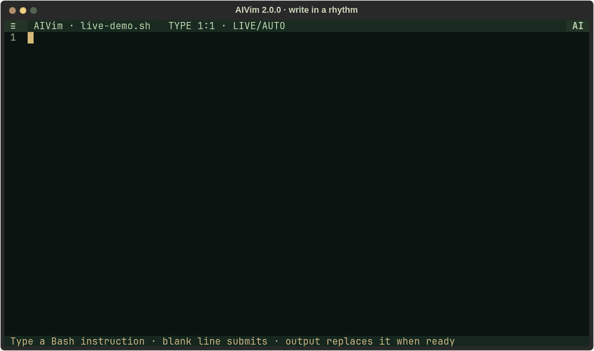
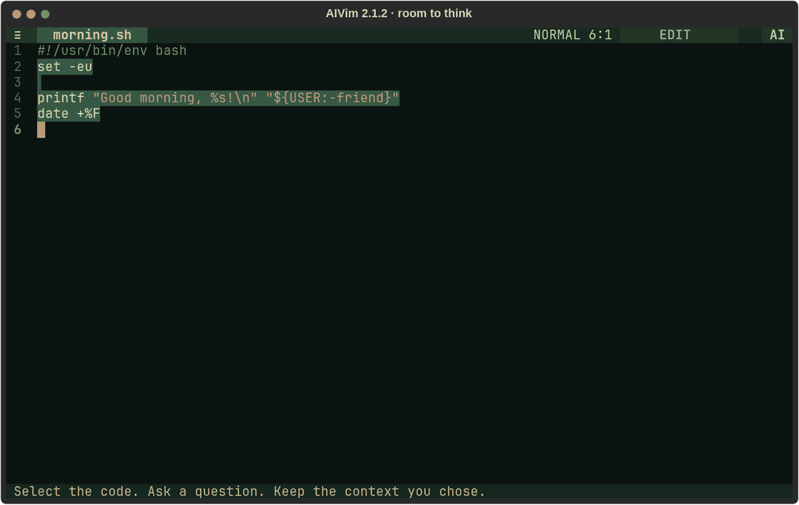
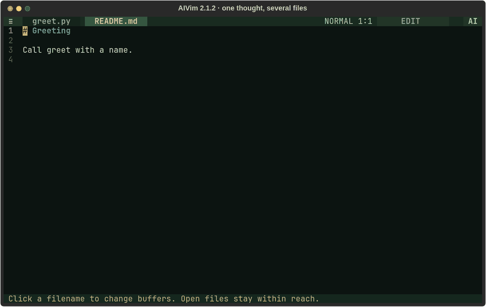
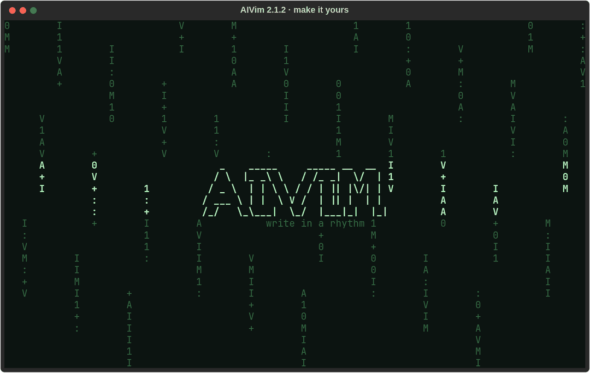

<div align="center">

# AIVim

### Write what you want. Keep typing. Let the code catch up.

A terminal editor with Vim keys, mouse controls, and AI that works with your context.

[](https://pypi.org/project/aivim/)
[](https://github.com/danimoya/AIVim-Editor/releases/tag/v2.1.2)
[](https://github.com/danimoya/AIVim-Editor/actions/workflows/qualification.yml)
[](pyproject.toml)
[](LICENSE)

[Get started](#get-started) · [Watch the workbench](#room-to-think) · [Project context](#one-thought-several-files) · [Models](#bring-your-own-model) · [Docs](#go-further)

</div>

## Write in blocks. Watch them become Bash.

[](docs/assets/live-bash-2.0.gif)

**Three prompts. Three live replacements. Keep writing while AI works.**

A blank line submits an instruction. The next block can begin while the previous
one is generating. Review the result, or enable **Auto replace** to replace completed
blocks as they arrive. Each accepted block is one undoable edit.

This is the original three-block recording, using a real local model. Inference
pauses are shortened. Generated Bash is syntax-checked and never executed.

## Get started

```sh
pipx install 'aivim[terminal-syntax]==2.1.2'
aivim demo.sh
```

Python **3.9+** and a terminal with Unicode support. The `terminal-syntax` extra
adds highlighting; the base package also supports the workspace and AI actions.
Model weights are served separately.

Connect an OpenAI-compatible or OpenShift endpoint with `aivim --connect`, or
[configure your local server or cloud provider](#bring-your-own-model).

## Room to think

[](docs/assets/workbench-2.1.2.gif)

**Select → ask → read. Make room whenever you need it.**

Mouse selection or Vim Visual mode gives AI a precise target. **F2 / right-click**
opens Rewrite, Generate, Explain, Analyze, and Ask. Checked sources add context.

**⛶ Full screen** puts the prompt, actions, and model/context controls on the left,
with the streaming response on the right. **Hide/Show controls** or **Alt+B** expands
the reading space without losing the prompt. **Esc / Restore** returns to the
previous floating or pinned view. Accept/Reject stay with the response, and Cancel
remains available during generation when the controls are hidden.

## One thought, several files

[](docs/assets/project-2.1.2.gif)

**Bring the context. Review the changes. Keep the final say.**

Click filenames to change buffers. In **Describe the project change**, type **@**
to complete open and recent filenames. The five-line prompt scrolls as it grows;
Enter adds a line and **Ctrl+Enter** submits.

AI proposes a set of file changes. Inspect the diffs and choose which hunks to
apply. A private checkpoint supports rollback. Project search, explicit command/test
execution, instruction refinement, and optional language-server tools are available
through **Ctrl+P**.

```sh
aivim --project ./my-project
```

[Explore the project workflow →](docs/PROJECTS.md)

## Make it yours

[](docs/assets/controls-2.1.2.gif)

**Retro character. Modern controls. Your pace.**

Only two rows are permanent: the title/menu bar and the status line. An 80×24
terminal leaves **80×22 cells** for the editor. Floating controls appear on demand;
**Pin** docks the Workbench, and **Collapse** returns the space to your document.

Click the top-bar mode to rotate **Edit → Live review → Live auto-replace**.
Open **Settings & view → Settings** for:

| Editing | Motion and appearance |
| --- | --- |
| Vim or standard typing | Spinner, pulse, Matrix, or static AI activity |
| Line numbers and indentation | Matrix-style AIVIM startup or no startup effect |
| Tabs or spaces | Typing, instant, or Matrix live-code previews |
| Optional AI history persistence | Reduced motion |

The palette respects `NO_COLOR`; the font comes from your terminal. Decorative
streaming effects stay separate from accepted document edits.

<details>
<summary><strong>About these recordings</strong></summary>

All clips capture the actual terminal app. The original three-block Bash demo is
preserved above. The new Workbench and project clips use real Olares1 model replies;
the settings clip records UI interactions without a model request. Playback is
edited for pace, including shortened inference waits. Generated commands are not
executed. Demo files, recovery data, and preferences use temporary directories.

Recording details: [Live Bash](docs/assets/live-bash-2.0-demo.json) ·
[Workbench](docs/assets/workbench-2.1.2-demo.json) ·
[Project](docs/assets/project-2.1.2-demo.json) ·
[Controls](docs/assets/controls-2.1.2-demo.json).

</details>

## Bring your own model

| Provider | Connection |
| --- | --- |
| **HTTPS / OpenShift** | `aivim --connect`: paste an API route, discover or enter a model ID, and provide an optional bearer token/private CA. |
| **Local server / Olares / Ollama** | Configure the OpenAI-compatible API URL and model ID. The Olares provider supports ordered LAN and Tailscale routes. |
| **OpenAI** | Set `OPENAI_API_KEY`; start with `--model openai`. |
| **Anthropic** | Set `ANTHROPIC_API_KEY`; start with `--model claude`. |
| **Local GGUF** | Optional isolated native inference worker; see the [terminal guide](docs/TERMINAL.md). |

HTTPS certificates are verified, including private CAs when configured. Tokens stay
in memory unless you choose **Remember token**, which uses a separate private file.
The local-server provider falls back on connection failure without silently
switching to a paid cloud provider or replaying a partial response.

[Connection setup, HTTPS, LAN/Tailscale, and configuration →](docs/TERMINAL.md)

## A few keys to get moving

| Control | Action |
| --- | --- |
| **F4** | Switch Vim / standard typing |
| **F2 / right-click** | Selection actions and context |
| **F5 / F6 / F7** | Generate / explain / rewrite |
| **F8** | Accept the completed proposal |
| **F9** | Toggle Live blocks |
| **F3 / Alt+2** | Sources |
| **Alt+A** | Open/collapse AI Workbench |
| **Alt+B** | Show/hide full-screen AI controls |
| **Ctrl+P** | Search commands |
| **Ctrl+S / Ctrl+O / Ctrl+N** | Save / open / new buffer |
| **Ctrl+Q / F10** | Quit with unsaved-buffer handling |

<details>
<summary><strong>Vim keys, live blocks, and recovery</strong></summary>

Vim-style input includes `h/j/k/l`, `w/b/e`, `0/^/$`, `gg/G`, Insert mode,
Visual selection, counts, line copy/delete, paste, and undo. Commands include
`:w`, `:wq`, `:q`, `:e`, `:new`, `:tabnext`, and `:tabprev`. Full Vim runtime/plugin
compatibility remains outside this release. **F4** gives you standard typing.

For Live blocks, enter an instruction and finish with a blank line. A single Enter
continues the same block. The queue stays ordered while you type. Review is the
default; Auto replace is an explicit choice. Editing a pending instruction keeps
your newer text and makes the old result stale. Paste, undo, and redo do not submit
requests. Turn Live off for ordinary code editing.

Sources can contain text files, Markdown, code, notes, or buffer snapshots. Check
what a request may use; Context shows the selected snapshots and optional nearby
text. Language defaults use the prompt, file extension/content, and open project
files. Requests have a 50 KiB selection/context budget and an 8 KiB instruction limit.

Local recovery keeps buffers, cursors, and source snapshots; Live starts off after
restoration. AI history persistence is opt-in. Transactional saves preserve loaded
encoding, newline conventions, permissions, and symlinks, and check external changes.

**Ctrl+Enter** submits AI instructions when your terminal reports that key.
**Shift+mouse** usually uses the terminal's native selection/copy behavior.
**F1** opens the complete field manual.

</details>

## Go further

| Guide | What you will find |
| --- | --- |
| [Terminal workspace](docs/TERMINAL.md) | Setup, providers, mouse/keyboard controls, effects, and recovery |
| [Projects](docs/PROJECTS.md) | Context search, multi-file review, checkpoints, commands, and language servers |
| [Browser companion](docs/WORKSPACE.md) | The optional CodeMirror workspace: `aivim-web --port 5000` |
| [Release notes](https://github.com/danimoya/AIVim-Editor/releases/tag/v2.1.2) | What's new in 2.1.2 |
| [Contributing](CONTRIBUTING.md) | Development and contribution guidance |
| [Release and rollback](docs/RELEASE.md) | Packaging and qualification |

The original editor is available with `aivim --classic file.py`. Neovim embedding
remains an evaluated prototype; the terminal workspace uses Textual.

<details>
<summary><strong>Install from source, develop, or record a demo</strong></summary>

```sh
git clone https://github.com/danimoya/AIVim-Editor.git
cd AIVim-Editor
python -m venv .venv
source .venv/bin/activate                 # Windows: .venv\Scripts\Activate.ps1
python -m pip install -e '.[test,build,demo,terminal-syntax]'
python -m playwright install chromium
```

```sh
python -m pytest verification
python -m unittest tests.test_buffer tests.test_history tests.test_utils
python scripts/check_source.py
python scripts/bump_version.py --validate
python -m build
```

For frontend changes: `npm ci`, `npm test`, and `npm run build`.

Record the three-block live workflow with `python scripts/record_live_demo.py`.
Record the current capability tours with:

```sh
python scripts/record_readme_demos.py --provider olares
# Or choose one: --scene workbench / project / controls
```

The recorders use your configured model and export GIFs, posters, and sanitized
recording details to `docs/assets/`. Bash is checked with `bash -n`; generated code
is not executed. Interface state is isolated from your normal workspace.
See [the script guide](scripts/README.md) for the other recorders.

</details>

---

**[GPL-3.0-only](LICENSE)** · Bundled frontend dependency notices:
[THIRD_PARTY_LICENSES.txt](aivim/web/static/THIRD_PARTY_LICENSES.txt).
