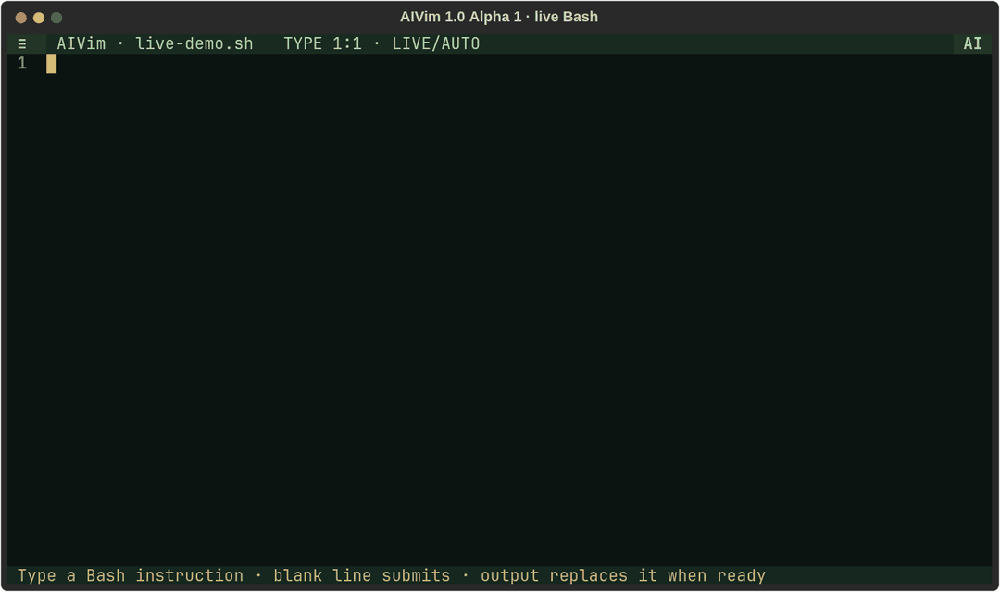
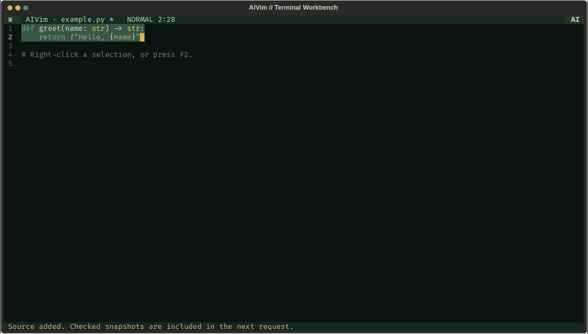
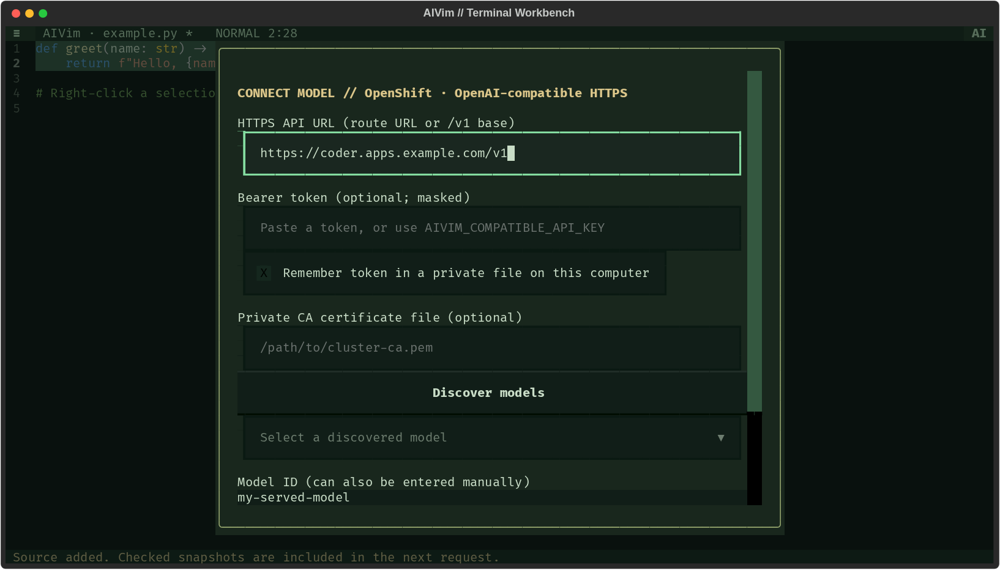

<div align="center">

# AIVim

### 1.0 Alpha · a small terminal editor with AI on demand

Write what you want. Keep typing. Let the code catch up.

[](https://github.com/danimoya/AIVim-Editor/releases/tag/v1.0.0-alpha.1)
[](https://github.com/danimoya/AIVim-Editor/actions/workflows/qualification.yml)
[](pyproject.toml)
[](LICENSE)

</div>

AIVim combines Vim-style keys, familiar typing, mouse selection and contextual AI
in a minimal terminal workspace. The editor keeps the screen; menus and AI controls
appear when you ask for them.

## See live blocks become Bash

[](docs/assets/live-bash.gif)

This recording uses a real local model. Three instructions become Bash while the
editor stays responsive. Idle inference pauses are shortened; typing and live
replacements are real. Generated commands are syntax-checked and **never executed**.
[Recording provenance](docs/assets/live-bash-demo.json) · [Reproduce the demo](#record-your-own-demo)

<details>
<summary><strong>Workspace carousel — editor, floating AI, menus and HTTPS setup</strong></summary>



<table>
<tr>
<td align="center"><a href="docs/assets/terminal-workspace.png"></a><br />Editor</td>
<td align="center"><a href="docs/assets/terminal-ai.png"></a><br />Floating AI</td>
<td align="center"><a href="docs/assets/terminal-actions.png"></a><br />Context menu</td>
<td align="center"><a href="docs/assets/terminal-connect.png"></a><br />Connect a model</td>
</tr>
</table>

Click a thumbnail for its full-size capture. The carousel is an animated image,
so it works directly in GitHub without JavaScript.

</details>

## Start in a minute

Python **3.9+**, Git, and a terminal with Unicode support are required.

```sh
git clone --branch v1.0.0-alpha.1 https://github.com/danimoya/AIVim-Editor.git
cd AIVim-Editor
python -m venv .venv
source .venv/bin/activate                 # Windows: .venv\Scripts\Activate.ps1
python -m pip install '.[terminal-syntax]'
aivim demo.sh
```

Or install the alpha in an isolated command-line environment:

```sh
pipx install 'aivim[terminal-syntax] @ git+https://github.com/danimoya/AIVim-Editor.git@v1.0.0-alpha.1'
```

The base package works without native syntax parsers; `terminal-syntax` adds
highlighting. No model weights are bundled. Connect a provider before using AI:

```sh
aivim --connect
```

## An editor that leaves room to edit

Only **two rows** are permanent: a compact title/menu bar and a status line. An
80×24 terminal leaves **80×22 cells** for the editor.

- Click **≡** for files, buffers, sources, history, live options and view settings.
- Select with the mouse or Vim Visual mode; **right-click / F2** opens contextual actions.
- **Alt+A** opens floating AI controls without shrinking the editor. **Pin** docks
  them beside your document; **Collapse** returns the space.
- **Ctrl+P** searches commands. Line numbers and the shortcut bar are optional.
- **F4** switches between Vim-style modal keys and standard typing.

The retro green-and-amber palette follows your terminal's font. `NO_COLOR` is
respected. Files are saved with Ctrl+S; changing buffers does not redirect a
pending AI result into another document.

## Live blocks: intent → code

1. Connect a model and open a file, such as `demo.sh`.
2. Press **F4** for standard typing, or `i` to use Vim Insert mode.
3. Press **F9** to enable Live blocks. Enable **Auto replace** from the **≡** menu
   if you want completed proposals applied automatically.
4. Write an instruction. A single Enter continues it; a **blank line submits it**.
5. Continue writing the next instruction while AI works.

```text
Print Hello.

Show the current directory disk usage in human-readable form.

Count regular files in the current directory, without recursion.

```

Output streams into the AI preview. Review is the default; **F8** accepts a proposal.
With Auto replace enabled, validated output replaces its original instruction as
one undoable edit. Partial tokens stay in the preview. Editing a pending instruction
makes its result stale and preserves your newer text.

Blocks queue in order, and normalized line endings keep later block positions
correct. **Undo restores an instruction.** Paste, undo and redo do not submit by
themselves. Turn Live off before editing ordinary code.

## AI that works on the text you choose

Select a function, paragraph or data snippet, then ask AI to **rewrite, explain,
analyze, answer a question or generate something new**. Add your own instruction
and inspect the proposed diff before accepting it.

Open **Sources** with **F3**. Add text files, Markdown, code, multiline notes, or a
snapshot of the current buffer. Check exactly which sources the next request can
read. Context preview shows those snapshots and optional nearby document text.
Unchecked sources are excluded.

**History** keeps the session's prompts, target/context snapshots, results and
acceptance decisions. Sources and history are held in memory and clear on exit;
save the documents you want to keep.

## Bring your own model

| Provider | Connection |
| --- | --- |
| **HTTPS / OpenShift** | `aivim --connect`: paste the route, discover or enter a model ID, and supply an optional bearer token/private CA. |
| **Local server / Olares** | OpenAI-compatible Chat Completions with ordered LAN and Tailscale routes. Model ID and URLs are configurable. |
| **OpenAI** | Set `OPENAI_API_KEY`; choose the configured model with `--model openai`. |
| **Anthropic** | Set `ANTHROPIC_API_KEY`; select `--model claude`. |
| **Local GGUF** | Optional isolated native inference worker; see the [terminal guide](docs/TERMINAL.md). |

The HTTPS setup verifies certificates, supports private cluster CAs, and provides
model discovery. Tokens stay in memory unless **Remember token** is selected; a
remembered token is stored in a separate user-private file, outside the repository
and JSON settings. `AIVIM_COMPATIBLE_API_KEY` is also supported.

The local-server provider tries its preferred route on every request and falls
back on connection failure. It never silently switches to a paid cloud provider
or replays a partial stream. It can connect to a compatible local llama-server or
Ollama API when configured with that server's URL and model ID.

[HTTPS, LAN/Tailscale and configuration details →](docs/TERMINAL.md)

## Small set of keys, full mouse access

| Key | Action |
| --- | --- |
| **F1** | Field manual |
| **F2 / right-click** | Selection actions |
| **F3** | Sources |
| **F4** | Vim / standard typing |
| **F5 / F6 / F7** | Generate / explain / rewrite |
| **F8 / F9** | Accept proposal / toggle Live |
| **Alt+A** | Floating AI controls |
| **Ctrl+P** | Command palette |
| **Ctrl+S / Ctrl+O / Ctrl+N** | Save / open / new |
| **Alt+1 / Alt+2 / Alt+3** | Editor / Sources / History |
| **Ctrl+Q / F10** | Quit with unsaved-buffer handling |

Vim-style input supports familiar movement, insertion, visual selection, basic
counts, line copy/delete, paste and undo. `:w`, `:wq`, `:q`, `:e`, `:new` and tab
navigation are available. F2 is the fallback when your terminal reserves right-click;
Shift+mouse typically uses the terminal's native copy/selection behavior.

## What 1.0 Alpha means

This is **1.0 Alpha 1**, packaged as `1.0.0a1` and tagged `v1.0.0-alpha.1`. It is a
prerelease of the new interface, with useful Vim vocabulary rather than complete
Vim runtime/plugin compatibility. Persistent workspaces/history, language-server
features, PDF/URL ingestion and per-hunk acceptance are outside this alpha.

Saving uses transactional writes, preserves loaded encoding/newline conventions,
permissions and symlinks, and checks for external changes. AI output is validated
before application and generated code is never executed automatically. These
checks protect editing operations; they do not establish generated-code quality.

The original editor remains available with `aivim --classic file.py`. An optional
CodeMirror browser workspace ships with `aivim-web --port 5000`; the terminal app
runs independently of it. See the [browser guide](docs/WORKSPACE.md).

## Develop and verify

```sh
python -m pip install -e '.[test,build,terminal-syntax]'
python -m playwright install chromium
python -m pytest verification
python -m unittest tests.test_buffer tests.test_history tests.test_utils
python scripts/check_source.py
python scripts/bump_version.py --validate
python -m build
```

To change the optional browser frontend:

```sh
npm ci
npm test
npm run build
```

Verification covers real Textual event loops, POSIX terminal sessions, Chromium
journeys, real SDK calls to loopback HTTP/HTTPS fixtures, certificate/token checks,
source exclusion, live queues, stale results, Unicode, saving and undo. Installed-wheel
checks verify packaged assets and terminal entrypoints. The
[Qualification workflow](https://github.com/danimoya/AIVim-Editor/actions/workflows/qualification.yml)
checks supported OS/Python combinations. Local live-model checks are separate from
isolated regression tests; hardware, entitlements and generation quality vary.

### Record your own demo

```sh
python -m pip install -e '.[demo,terminal-syntax]'
python -m playwright install chromium
python scripts/record_live_demo.py
```

The recorder uses your configured model, captures actual UI frames, validates the
three replacements and runs `bash -n` without executing the result. It exports a
looping GIF, a poster and sanitized provenance to `docs/assets/`. Idle inference
pauses are shortened for readability. No server addresses or credentials are
included in the provenance.

[Terminal guide](docs/TERMINAL.md) · [Alpha release notes](docs/RELEASE_NOTES_1.0_ALPHA.md) · [Release and rollback](docs/RELEASE.md) · [Contributing](CONTRIBUTING.md)

**License:** [GPL-3.0-only](LICENSE). Bundled frontend dependency notices are
included in [THIRD_PARTY_LICENSES.txt](aivim/web/static/THIRD_PARTY_LICENSES.txt).
