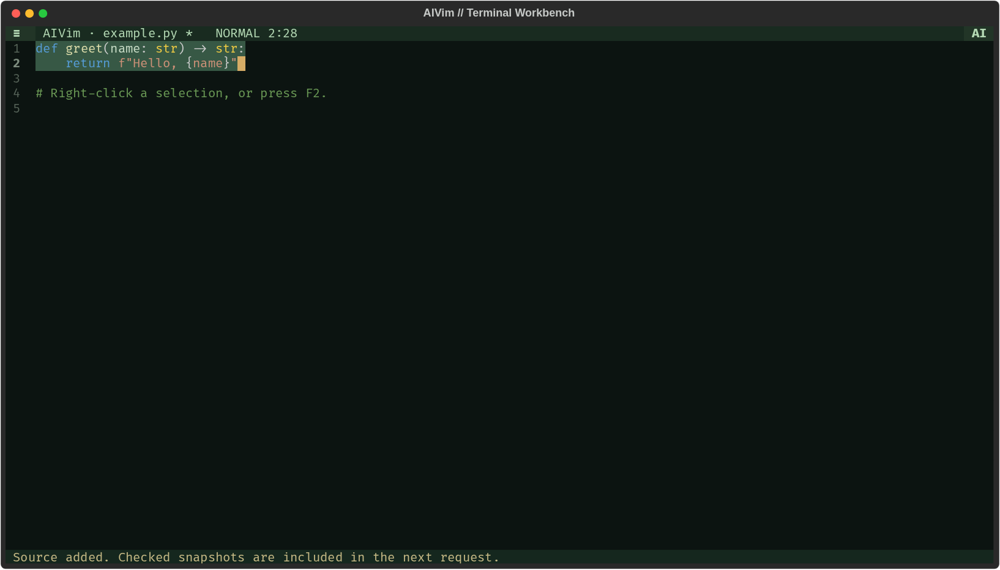
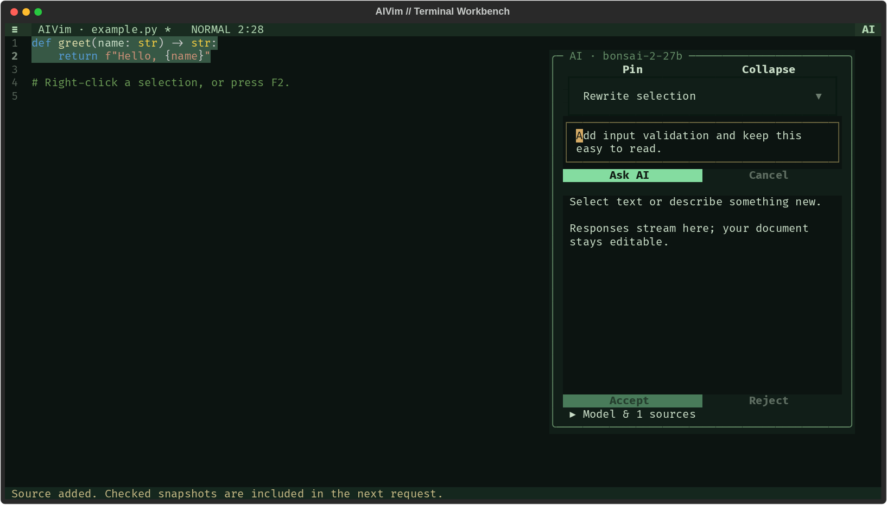
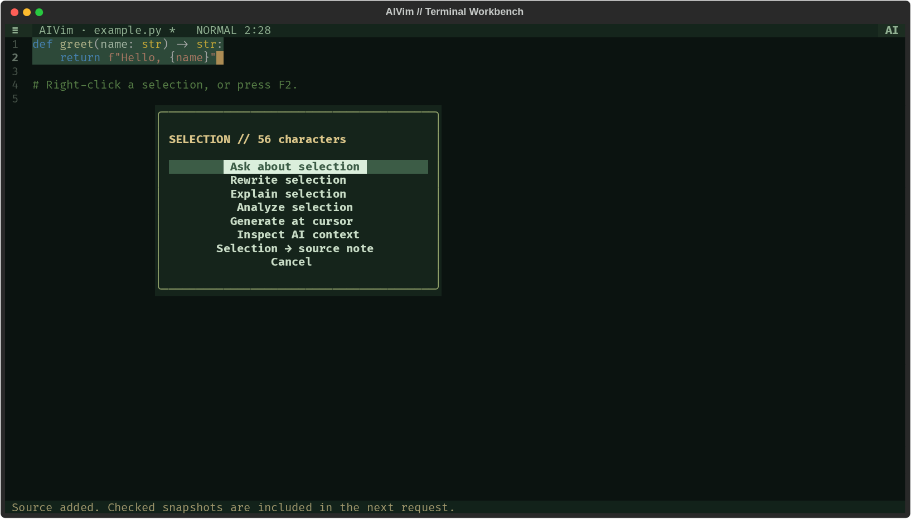

# Terminal workbench

AIVim now starts a Textual terminal application. Run it directly from your shell:

```sh
cd AIVim-Editor
.venv/bin/aivim document.py
```

For another development checkout, install with
`python -m pip install -e '.[terminal-syntax]'`. The `terminal-syntax` extra adds
syntax highlighting. The base install supports editing and all workspace actions
without native syntax parsers. AI credentials/configuration are shared with the
existing provider adapters; no browser or web server is needed.



The interface uses a restrained dark-green palette, amber accents, line-numbered
editing, floating menus and mouse-aware widgets. It respects `NO_COLOR`;
if your shell exports it and you want the palette, run
`env -u NO_COLOR .venv/bin/aivim document.py` on POSIX systems. Your terminal
controls the font. Syntax parsers support highlighting when installed.

## Connect an OpenShift HTTPS model

Run `aivim --connect`, choose **Connect HTTPS model** in Ctrl+P, or open the AI
Workbench and click **Connect HTTPS model…**.

1. Paste the OpenShift route or OpenAI-compatible API base URL. A bare route
   gets `/v1` appended; pasted `/v1/chat/completions` URLs are normalized too.
2. Paste a bearer token into the masked field if authentication is required.
   You can instead export `AIVIM_COMPATIBLE_API_KEY` before starting AIVim.
3. If your cluster uses a private CA, enter its PEM certificate file path.
   Certificate and hostname verification remain enabled.
4. Click **Discover models**, choose the served ID, or enter the ID manually
   if the server does not expose `/models`.
5. Click **Save & use**. The `compatible` provider becomes the default.

Tokens stay in the current process unless you select **Remember token**. Remembered
tokens go in a separate private file under `~/.local/state/aivim/keys/`, with mode
600 (or a user-only ACL on Windows); settings store its path, not its contents.
Existing Olares endpoint settings are preserved when adding an HTTPS connection.
The HTTPS provider has no automatic fallback to other providers or hosts, and
ignores HTTP proxy environment variables. Connections use standard Chat Completions
and support streaming, selection actions, sources and live blocks.

For configuration management, the corresponding settings are:

```json
{
  "schema_version": 1,
  "ai": {
    "default_model": "compatible",
    "compatible_base_url": "https://coder.apps.example.com/v1",
    "compatible_model": "my-served-model",
    "compatible_ca_file": "/optional/path/to/cluster-ca.pem",
    "compatible_token_env": "AIVIM_COMPATIBLE_API_KEY"
  }
}
```

Omit `compatible_ca_file` when the route uses a publicly trusted certificate. API
tokens belong in the environment or the connection dialog, not in JSON settings.

## Minimal interface and floating controls

The default editor uses the whole window apart from a one-line title/menu bar and
a one-line status bar. An 80×24 terminal provides 80×22 cells for editing. There
are no permanent file toolbar, tabs, live checkboxes, sidebar rail or shortcut bar.
The title shows the buffer, dirty state, input mode, cursor position and live/AI state.

- Click **≡** for Files & buffers, AI actions, Sources, History, Live blocks, Auto
  replace, connection setup, view options, and Help.
- Right-click or F2 opens selection actions at the pointer. Menus use one row per
  action; arrows/Enter or the mouse select items, and Escape dismisses them.
- Ctrl+P exposes searchable commands, including file/view and live controls.
- Alt+A or the title-bar **AI** button opens a temporary floating Workbench. It
  overlays the editor without changing its dimensions and hides when you return
  to typing or clicking in the editor. Model/source details fold away by default.
- **Pin** docks the Workbench beside the editor; **Unpin** makes it float again.
  **Collapse** restores all editing space. These choices apply to the session.
- **View & keys** in the menu toggles line numbers, the optional shortcut bar, and
  Vim/standard input. Sources and History are full-window views opened only when
  requested; Alt+1 returns to editing.

Live generation stays in the background and never opens the panel or takes focus.
Only an explicit AI action opens the floating controls.



## Olares LAN / Tailscale provider

Select `olares` or start with `aivim --model olares`. Configure the model ID and
ordered API base URLs in `~/.config/aivim/settings.json`, for example:

```json
{
  "schema_version": 1,
  "ai": {
    "default_model": "olares",
    "olares_model": "bonsai-2-27b",
    "olares_base_urls": [
      "http://LAN_HOST:8085/v1",
      "http://TAILSCALE_HOST:8085/v1"
    ],
    "olares_connect_timeout": 2,
    "timeout": 120,
    "max_tokens": 4096,
    "temperature": 0.2,
    "retry_on_error": false,
    "max_retries": 0
  }
}
```

Replace the example hostnames with your server's addresses. Every request starts
with the first route and advances on a connection error or connect timeout. HTTP
errors, an interrupted response and partial streams do not trigger route replay.
The transport opens a fresh connection per request so a stale pooled LAN connection
does not delay failover after moving networks. HTTP proxy environment variables are
ignored for this provider. It uses a local placeholder credential; cloud API keys
are never forwarded. There is no automatic cloud fallback. The server must already
be running its configured model and allow the workstation to reach its API port.

## Mouse and keyboard

Click to position the cursor, drag to select, and right-click the editor for a
context menu. Right-click preserves the current selection. Hover over controls
for tooltips. F2 opens the same menu when a terminal reserves right-click for its
own menu. Mouse events depend on the terminal emulator's mouse-reporting support;
Shift+mouse typically provides its native selection/copy behavior.



| Control | Action |
| --- | --- |
| F1 | Field manual |
| F2 / right-click | Selection actions and context preview |
| F3 / Alt+2 | Sources |
| F4 | Toggle Vim keys / standard editing |
| F5 | Focus generation instructions |
| F6 / F7 | Explain / rewrite the selection |
| F8 | Accept the completed proposal |
| F9 | Toggle live instruction blocks |
| F10 / Ctrl+Q | Quit, with a dirty-buffer decision when needed |
| Ctrl+S / Ctrl+O | Save / open a file |
| Ctrl+N / Ctrl+W | New / close a buffer |
| Ctrl+Enter | Submit AI request, where the terminal reports this key |
| Ctrl+P | Command palette with workspace actions |
| Alt+1 / Alt+3 | Editor / session history |
| Alt+A | Open/collapse the floating AI Workbench |

The default input mode is Vim Normal mode: `i` starts typing and Escape returns
to Normal. F4 switches to familiar typing and Shift+arrow selections. Mouse
selection works in both modes. The supported modal vocabulary includes
`h/j/k/l`, `w/b/e`, `0/^/$`, `gg/G`, `i/a/A/I/o/O`, `v/V`, `x`, `dd`, `yy`,
`y`, `p/P`, `u`, and Ctrl+R. Character/line visual selections support letter and
arrow motions. Basic numeric counts work with movement, deletion and line copy.
This implements a subset of Vim, not its full runtime, macros or plugin ecosystem.

`:w`, `:w!`, `:w path`, `:saveas path`, `:wq`, `:q`, `:q!`, `:e path`, `:new`,
`:tabnext` and `:tabprev` are available through the command prompt. The original
curses editor is available with `aivim --classic document.py`; its wider command
vocabulary and embeddable API remain available.

The editing layout remains minimal at both 80×24 and wider sizes. Floating panels
and dialogs scroll when necessary. Tab/Shift+Tab and the mouse move through their
controls; Escape closes menus, and Alt+A collapses the AI panel.

## Selection and source workflow

1. Open a document with Ctrl+O, or select **AI New** to generate a new buffer.
2. Open **Sources** and add files, a multiline note, the current buffer, or a
   selection via the context menu. These are read-only snapshots.
3. Check which sources the next AI request can read. Unchecked sources are excluded.
4. Select text in the editor, enter instructions if needed, then choose an action.
5. Inspect streamed output and the final diff. Accept with F8 or reject.
6. Undo with `u` in Normal mode, Ctrl+Z in standard mode, or the Undo button.

The **Context** button shows the exact checked source snapshots plus optional
nearby document text (up to 2,000 characters on each side). The model receives
the selected target and that context. Generation receives the instruction and
context, without forwarding the entire document. Nothing executes generated code.
Questions and explanations remain outside your document.

Requests capture their originating buffer and target. Switching buffers does not
redirect a result. Edits outside a pending selection are preserved and move its
anchors; touching the target invalidates the result. Undo/redo conservatively
invalidates pending requests for that buffer. Repeated identical instructions use
exact edit spans so deleting one cannot silently redirect its response to another.
A complete provider response is validated with the existing proposal parser.
Truncated or failed output never becomes an applicable edit.

## Live natural-language blocks

Enable **Live blocks** on a blank line. A single Enter continues the instruction;
a blank line submits the completed block. Keep typing the next block while output
streams into the AI panel. Pasting, undo and redo do not submit automatically.

```text
Create a function that adds two numbers.
Include type hints and a docstring.

Create an example that calls the function.

```

By default, each completed result waits for review. The next queued block waits
until you accept or reject it. Enable **Auto replace** to replace an intact
instruction automatically when its complete output validates. Partial tokens stay
in the preview. This avoids changing your cursor position for every token, and
makes replacement one undoable edit. Undo restores the original instruction.

Generated CRLF/CR line endings are normalized using the editor's actual inserted
length, so subsequent blocks keep the correct position. Starting another instruction
on a blank line before the last cursor location re-arms that line. The live status
shows generating, queue size, review pending, or ready. Enabling Auto replace also
applies a valid live proposal already waiting for review.

At most ten blocks wait in the queue. Each captures its checked sources and provider.
Cancel clears waiting work and cancels the active request. Turning Live off cancels
active/queued live work. Turn it off before editing ordinary code: live mode treats
newly typed blocks as instructions. Local GGUF inference uses the existing bounded
worker and shows a completed result instead of token-by-token output.

## Files, privacy and scope

Saving uses the existing transactional FileStore: loaded UTF-8/BOM, newline style,
symlinks, permissions, backups and external-change checks are retained. Save failure
preserves the buffer. Existing files are never overwritten implicitly on Save As.
`:w!` is the explicit overwrite action after a conflict. Closing a dirty buffer or
quitting with unsaved changes offers saving, discarding, or keeping the editor open.

Private recovery snapshots preserve buffers, cursors, source choices and preferences.
The latest 50 AI history entries persist only when explicitly enabled. History
includes target/context snapshots, prompts, responses and decisions. Sources are not
rewritten when an AI proposal is accepted. Documents are saved only when requested.
Editing accepts up to 20 MiB files and 20 open buffers. AI requests accept up to
50 KiB each of selection and context, and 8 KiB instructions. Each source is limited
to 50 KiB, with at most 30 sources. Oversized inputs fail visibly; they are not
silently truncated. The provider must be configured before an AI request is sent.

This stable release does not include complete Vim compatibility, PDF/URL ingestion,
a language server, or per-hunk acceptance. Project tooling follows in 2.0.

## Development and verification

The new UI lives in `aivim/tui.py`, `tui_widgets.py`, `tui_model.py` and `tui.tcss`.
The shared provider/proposal/file services are reused. No browser bundle is involved
in terminal rendering. Browser workspace work remains available independently.

```sh
python -m pytest verification
python -m unittest tests.test_buffer tests.test_history tests.test_utils
python scripts/check_source.py
python scripts/bump_version.py --validate
uv lock --check
python -m build
```

The terminal tests exercise real Textual event loops and SDK calls to loopback HTTP
stubs. They cover right-click selection preservation, modal and standard editing,
Unicode, source exclusion, streaming, review/undo, buffer ownership, stale results,
live queues, cancellation, external-file conflicts, dirty exit and compact layout.
POSIX PTY tests separately run both the classic and new CLI entrypoints, checking
mouse reporting, menus, resizing, save and exit. Live-account entitlements and
provider generation quality are not established by the stub tests.

## Stable daily workflow

Ctrl+F (or `/` in Vim mode) finds literal text; `n`/`N` repeat the search.
Ctrl+H replaces all literal matches as one undo step. Ctrl+G or `:42` goes to a line.
The command palette offers a floating File picker and Indentation controls.

Every two seconds the workspace writes a private atomic recovery snapshot. On the
next ordinary `aivim` launch, buffers, cursor positions, source choices and view
preferences restore. Separate editor instances write separate snapshots. Live and
Auto replace start off; model requests never resume themselves. Save documents
explicitly as usual. AI history persistence is opt-in in Ctrl+P; Clear AI history
also clears history in previous snapshots for this configuration.

Ctrl+P exposes model profiles and Test model connection (including the selected
LAN/Tailscale route), individual Blocks retry/cancel, Source freshness, explicit
Refresh sources, Edit proposal and Check syntax. Syntax checks do not execute code.
Writing effect paints streamed previews over the original instruction and can be
disabled with Ctrl+P. The underlying document changes only after a complete proposal
is accepted. AI accepts selections up to 50 KiB in otherwise larger documents;
checked sources plus nearby context have a separate 50 KiB budget.


## 2.1 interface and effects

Filename buttons in the existing title row switch between open buffers. The rotating
mode button cycles Edit, Live review and Live auto-replace; it does not add a row.
Live submission always starts off after recovery. A small AI activity indicator
covers both ordinary and project generation.

Settings (Ctrl+P or Settings & view → Settings) persists input mode, line numbers,
tabs/spaces and indentation width, optional history, AI activity style, startup
style and live replacement style. Reduce motion disables startup/AI animation and
uses instant complete replacement. Typing and Matrix previews remain decorative:
partial output never enters the editable document or undo history. Keyboard input
skips startup before normal routing so the initial keystrokes remain ordered.

The AI panel's ⛶ button expands responses over the editing area. The title/status
rows remain visible. Esc or Restore returns to the prior pinned/floating view;
Collapse closes it. While full-screen output streams, scrolling away from the end
preserves your reading position.

Generation language defaults are inferred per request. Explicit output language
wins; otherwise shebang, meaningful filename extension, content and other open
project files provide context. The generated language is kept separate from optional
syntax-parser availability. Placeholder untitled Python filenames do not force Python.
